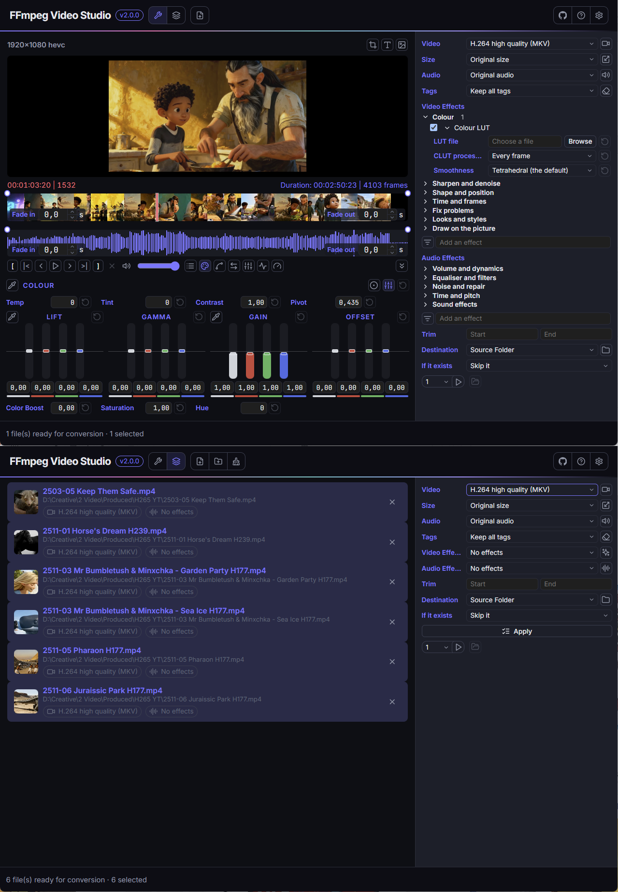

<p align="center">
  
</p>

<h1 align="center">FFmpeg Video Studio</h1>

<div align="center">
  <strong>Cut, grade, fade and convert video, with ffmpeg as the engine.</strong><br>
  See and hear what the conversion will make, then convert one file or a whole folder - without typing a command.
</div>

<br>

<!-- readme:nav -->

<div align="center">
  <a href="../../releases/latest"></a>
  <a href="../../releases"></a>
</div>

<h3 align="center">
  <a href="https://apps.yaiol.com/p/ffmpeg-video-studio/">Website</a>
  <span>&nbsp;·&nbsp;</span>
  <a href="#install">Install</a>
  <span>&nbsp;·&nbsp;</span>
  <a href="#what-it-is">Features</a>
  <span>&nbsp;·&nbsp;</span>
  <a href="#documentation">Documentation</a>
  <span>&nbsp;·&nbsp;</span>
  <a href="#build-from-source">Development</a>
</h3>

<div align="center">
  <sub><a href="https://apps.yaiol.com/p/ffmpeg-video-studio/help/"><b>Help in 28 languages</b></a></sub>
</div>

<!-- /readme:nav -->

---

<p align="center">
  
</p>

---

## Install

<div align="center">

<table align="center">
<tr>
<th align="center">Windows</th>
<th align="center">macOS</th>
<th align="center">Linux</th>
</tr>
<tr>
<td align="center"><a href="../../releases/latest"></a></td>
<td align="center"><a href="../../releases/latest"></a></td>
<td align="center"><a href="../../releases/latest"></a></td>
</tr>
<tr>
<td align="center">x64 installer</td>
<td align="center">Apple Silicon</td>
<td align="center">deb package or AppImage</td>
</tr>
</table>

</div>

> **Windows note:** SmartScreen may warn on first launch because the app is not code-signed. Click "More info", then "Run anyway".
>
> Windows is the platform the app is developed and tested on; the macOS and Linux packages are built from the same source on release and have had less use.

---

## What it is

FFmpeg Video Studio is a graphical studio on top of ffmpeg. The **work view** opens first: one video at a time, with a picture you can play with its sound, a film strip and a sound band for a timeline, a cut set with two buttons, fades you drag, and drawers for colour, curves, crop, texts and the sound. The **batch view** converts many files at once, each with its own settings.

What sets it apart is that the choices are kept separate: the **preset** (how the video is encoded), the **size**, the **audio**, the **tags**, the **effects** and the **trim** are each chosen on their own, so one preset serves every combination. ffmpeg is not hidden: a panel shows the exact command that will run, and a button copies it.

---

## Features

- **Hear and see the result** - playback is real ffmpeg with your effects applied, with the sound; the part outside the cut is dimmed on a film strip, and fades are two handles on the timeline.
- **Video Effects and Audio Effects** - ffmpeg's own filters as a searchable catalogue with ordinary controls, plus standard effects as switches: crop and rotate, colour grading with wheels or bars, curves, texts and watermarks as boxes on the picture, and for the sound an equaliser, a compressor, channels, level and loudness, fades and ReplayGain tags.
- **Presets** - MKV, MP4, WebM, MOV and AVI with H.264, H.265, AV1, VP9, ProRes, uncompressed RGB or a straight copy; a quality number or a target bitrate, a speed, 10-bit, tunes and extra x265 parameters.
- **A graphics card when it helps** - NVIDIA, AMD or Intel encoders, chosen as a setting. The app tests which ones work on your computer and falls back to the processor when a preset cannot use a card.
- **Tags and chapters** - keep everything except a list of names, or remove everything except a list, with wildcards; chapters have their own switch.
- **Per-file settings** - every file in the batch carries its own preset, size, audio, tags, effects, cut and destination.
- **Where the files go** - beside the source or into a chosen folder, with the folder structure kept, and skip, overwrite or keep-both when a file exists.
- **Your language** - the interface is available in 52 languages.

---

## Documentation

| | |
|---|---|
| **User manual** | [Read it online](https://apps.yaiol.com/p/ffmpeg-video-studio/help/) |
| **What's new** | [Release notes](https://apps.yaiol.com/p/ffmpeg-video-studio/help/releases/) |
| **Product page** | [apps.yaiol.com](https://apps.yaiol.com/p/ffmpeg-video-studio/) |

---

## Build from source

Requires the Rust toolchain (stable) and, for the installer, the Dioxus CLI (`cargo install dioxus-cli`). The app drives **ffmpeg**, which is not part of the repository and is not bundled: the app downloads the build yaiol has approved into a folder of its own the first time it starts, and never uses an ffmpeg found elsewhere on the machine.

```bash
cargo run -p ffmpeg-video-studio                                # run in development
cargo test                                                      # engine and app tests (the conversion tests need ffmpeg)
cd app && dx bundle --desktop --release --package-types nsis    # Windows installer → release/
```

---

## Architecture

A Cargo workspace of two crates: the **engine** (everything that is not the window - presets, effects, the job queue, the ffmpeg driver and the preview, with no UI dependency) and the **app** (the Dioxus desktop shell, which polls the engine every 200 ms; the engine never calls back into the window).

| Layer | Technology |
|-------|-----------|
| UI | Dioxus 0.7 on the system WebView |
| Video engine | ffmpeg, a separate executable the app downloads and installs itself |
| Preview sound | rodio |
| Interface languages | flat JSON bundles embedded at build time |
| Packaging | `dx bundle` (NSIS, deb, AppImage, dmg) |

<details>
<summary><b>How the effects run</b></summary>

The effects of a file run in the order of the list as one ffmpeg filter chain, or one filter graph when an effect needs a second input such as a watermark. The size limit sits where it must, and an effect listed before another that changes what it works on is reported, never reordered. The sound has its own chain; a tempo change or a cut of the sound is followed by the picture so the two stay the same length.

</details>

<details>
<summary><b>How the preview works</b></summary>

The picture is one ffmpeg run built from the same plan as a conversion, so what shows is what the effects will do; it is served to the window as a stream of pictures from a small server on the local machine. The sound is a second ffmpeg played through the default output.

</details>

---

## License

The app downloads [ffmpeg](https://ffmpeg.org) as a separate executable from its builders; it is not part of this repository or of the installer and keeps its own licence.

<div align="center">
  <sub>FFmpeg Video Studio is part of <a href="https://apps.yaiol.com">yaiol Applications</a>.</sub>
</div>
